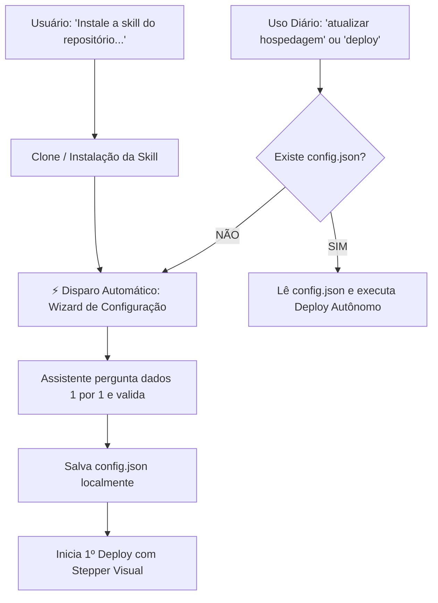

# 🚀 Hostinger Deploy Skill Template para Google Antigravity

[](https://antigravity.google)
[](https://hostinger.com)
[](https://nodejs.org)
[](LICENSE)
[](#-segurança-e-privacidade-zero-leaks)

Template universal de **Skill para Google Antigravity** projetado para realizar deploys automatizados de aplicações web (Node.js, Express, Next.js, Vite e estáticos) diretamente na **Hostinger Cloud / Web Hosting**.

Este repositório é **100% genérico e livre de dados pessoais ou credenciais**, pronto para ser forkado, clonado em repositórios abertos e distribuído para outros desenvolvedores ou equipes.

---

## ✨ Principais Funcionalidades

- ⚡ **Auto-Start no Fim da Instalação:** Ao pedir para o Antigravity baixar ou instalar a skill, ele **automaticamente inicia o Wizard de Configuração na mesma resposta**, sem precisar que o usuário digite nenhum comando extra!
- 🧙‍♂️ **Wizard de Configuração Guiado (1 por 1):** O assistente faz perguntas amigáveis e estruturadas, aguardando uma resposta por vez antes de prosseguir.
- 🚀 **Deploy 100% Autônomo:** Após configurada, as próximas publicações acontecem de forma direta, sem confirmações repetitivas ou travas no chat.
- 📊 **Interface com Stepper Visual:** Acompanhamento do progresso com gráfico de fluxo Mermaid, ícones e tabela de status em tempo real.
- 📜 **Logs Técnicos em Acordeão Fechado:** Mantém o chat limpo através de blocos retráteis (`<details>`), eliminando poluição visual no terminal.
- 🔒 **Segurança Total (Zero Leaks):** Credenciais e configurações locais ficam isoladas no arquivo `config.json` protegido pelo `.gitignore`.

---

## 🔄 Fluxo de Execução



---

## 📂 Estrutura de Arquivos

```text
hostinger-deploy-template/
├── SKILL.md              # Regras, triggers e prompts do Antigravity
├── config.example.json   # Exemplo limpo da estrutura de configuração
├── .gitignore            # Protege credenciais locais, pacotes e caches
├── LICENSE               # Licença oficial MIT
├── README.md             # Esta documentação
└── scripts/
    ├── package.sh        # Script shell para sincronização Git e geração do .tar.gz
    ├── setup_wizard.sh   # Assistente interativo via CLI
    └── verify_mcp.js     # Validador de integridade das ferramentas MCP Hostinger
```

---

## 🛠️ Pré-requisitos

Para que o Antigravity consiga se comunicar com a Hostinger, o servidor MCP oficial da Hostinger deve estar instalado no seu arquivo `mcp_config.json`:

```json
{
  "mcpServers": {
    "hostinger-hosting": {
      "command": "npx",
      "args": [
        "--package=@hostinger/mcp@latest",
        "hostinger-hosting-mcp"
      ]
    }
  }
}
```

---

## 📥 Como Instalar a Skill

### Opção 1: Diretamente pelo Chat do Antigravity (Recomendado)
Basta solicitar ao assistente no chat:
> *"Baixe e instale a skill de deploy da Hostinger do repositório: `https://github.com/cristofermello-dev/skills`"*

> [!TIP]
> **Inicialização Automática**: Assim que o download for concluído, o assistente **já iniciará o Wizard de Configuração imediatamente na mesma resposta**, fazendo a Pergunta 1/5!

### Opção 2: Instalação Global (Disponível em todos os projetos)
Clone o repositório na pasta de skills globais do Antigravity:
```bash
git clone https://github.com/cristofermello-dev/skills.git ~/.gemini/config/skills/hostinger-deploy-template
```

### Opção 3: Instalação por Projeto (Apenas no repositório atual)
Clone dentro da pasta `.agents/skills` do seu projeto:
```bash
mkdir -p .agents/skills
git clone https://github.com/cristofermello-dev/skills.git .agents/skills/hostinger-deploy-template
```

---

## 🎯 Como Utilizar

### 1. Wizard de Configuração (Auto-iniciado ou sob demanda)
O assistente guiará a configuração com 5 perguntas objetivas, **uma por uma**:

1. **Domínio:** O domínio cadastrado na Hostinger (ex: `meusite.com.br`).
2. **Usuário Hostinger (`username`):** O usuário da conta (ex: `u123456789`, exibido no painel hPanel).
3. **Caminho do Projeto:** Onde o código está salvo no seu computador (ex: `./` ou `/caminho/do/projeto`).
4. **Branch do Git:** A branch de produção para sincronização (padrão: `main`).
5. **Configurações da Stack:** Versão do Node (18, 20 ou 22), script de build e arquivo de entrada (ex: `server.js`).

Ao responder a última pergunta, o assistente valida o ambiente, gera o `config.json` local e já inicia o primeiro deploy!

---

### 2. Uso Diário (Deploy Autônomo)
Nas próximas vezes, basta dizer:
> *"atualizar hospedagem"* ou *"deploy"*

O assistente executará tudo de ponta a ponta sem interromper com perguntas:
1. Puxa os commits mais recentes do Git.
2. Empacota a aplicação ignorando arquivos desnecessários (`node_modules`, `.git`, `.env`).
3. Envia o pacote para o armazenamento da Hostinger via protocolo TUS.
4. Aciona o build Node.js e acompanha o status de compilação.
5. Reinicia a aplicação e limpa o cache LiteSpeed.
6. Valida a resposta do site ao vivo (`HTTP 200 OK`).

---

### 3. Exemplo do Retorno Visual no Chat

Quando o deploy é concluído, o resultado é exibido com um visual moderno e limpo:

```markdown
### 🚀 Deploy em Produção Concluído — meudominio.com.br

\`\`\`mermaid
graph LR
    A[📥 Git Sync] --> B[📦 Empacotamento]
    B --> C[🚀 Upload Hostinger]
    C --> D[⚙️ Build Node.js]
    D --> E[🔄 Restart & Cache]
    E --> F[🌐 200 OK Live]
    classDef done fill:#10b981,stroke:#059669,stroke-width:2px,color:#fff;
    class A,B,C,D,E,F done;
\`\`\`

| Etapa | Ícone | Ação | Status |
| :--- | :---: | :--- | :---: |
| **1. Git & Sincronização** | 📥 | *Pull `main` & checagem de commits* | Concluído (`8c89401 - feat: deploy`) |
| **2. Empacotamento** | 📦 | *Geração do pacote `deploy_package.tar.gz` (457B)* | Concluído |
| **3. Upload Hostinger** | 🚀 | *Transmissão TUS / Hostinger Storage API* | Concluído |
| **4. Build da Aplicação** | ⚙️ | *Compilação Node.js 20* | Concluído (32s) |
| **5. Reinício & Cache** | 🔄 | *Restart da aplicação & Purge LiteSpeed* | Concluído |
| **6. Health Check** | 🌐 | *Verificação de integridade ao vivo* | **HTTP/2 200 OK** |

> [!TIP]
> 🟢 **Deploy Concluído com Sucesso em Produção!**  
> **Domínio:** [meudominio.com.br](https://meudominio.com.br) | **Ambiente:** Hostinger Cloud

<details>
<summary><b>▶ 📜 Console de Execução & Logs Técnicos (Clique para expandir)</b></summary>

\`\`\`bash
[11:00:25] ==> Carregando configurações de: config.json
[11:00:26] ==> Sincronizando repositório Git local (main)...
[11:00:27] ==> Upload de deploy_package.tar.gz concluído com sucesso.
[11:00:45] ==> Compilação Node.js concluída com status: completed.
[11:00:48] ==> LiteSpeed Cache limpo e aplicação reiniciada.
\`\`\`

</details>
```

---

### 4. Reconfiguração
Se você trocar de projeto, domínio ou conta, basta digitar no chat:
> *"reconfigurar deploy"*

O assistente reiniciará o Wizard interativo e atualizará o arquivo `config.json` local.

---

## 🔒 Segurança e Privacidade (Zero Leaks)

- **Sem Credenciais Embutidas:** Nenhum dado pessoal, token de acesso pessoal do GitHub (`ghp_...`) ou credenciais da Hostinger são armazenados neste repositório.
- **Isolamento de Máquina:** O arquivo `config.json` e eventuais pacotes `.tar.gz` são listados no `.gitignore` e ficam restritos à máquina local onde o deploy é executado.

---

## 📄 Licença

Este projeto é distribuído sob os termos da licença **MIT**. Consulte o arquivo [LICENSE](LICENSE) para mais detalhes.
